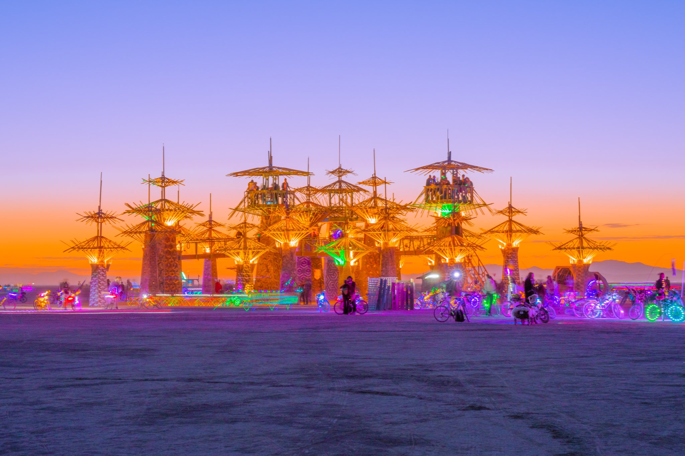
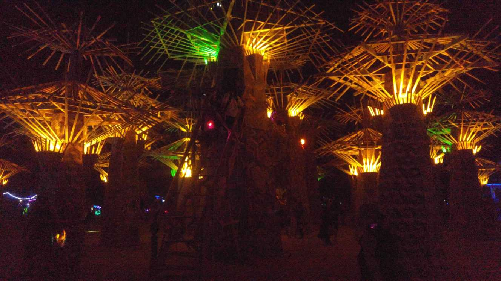
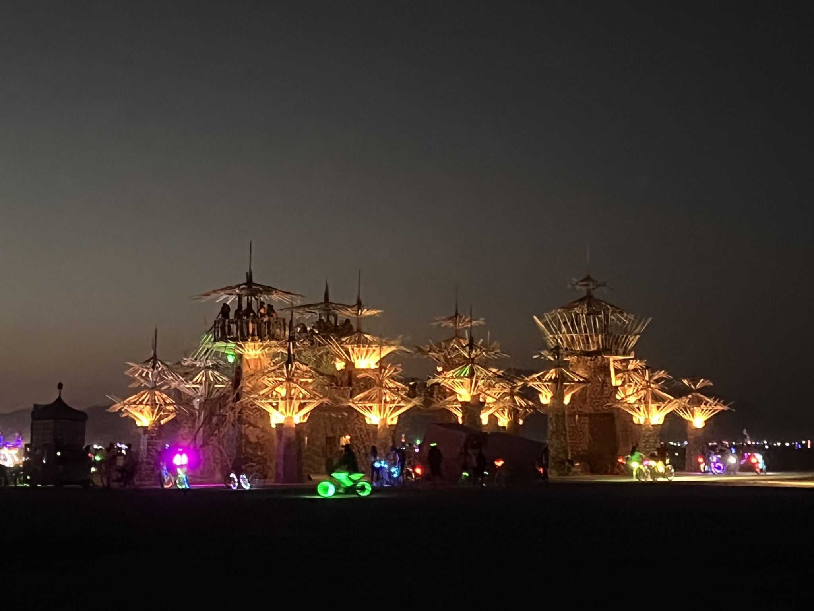

*Paradisium is a grove of trees reborn out of the ashes of [The Folly](/works/the_folly/).*

*Photo: [Mark Promson](http://www.markfromson.com/)*

# Involvement
- Lighting Design
- Network Design

## Links
- [Paradisium](https://www.follybuilders.com/paradisium)
- [Github](https://github.com/FollyBuilders/paradisium)

## Special Thanks
- [Mark Slee](http://mcslee.com): Creator of [LXStudio](https://lx.studio)
- [John "Parts" Taylor](https://lumigeek.com/): Helping out with the RGBWUA light fixture patterns
